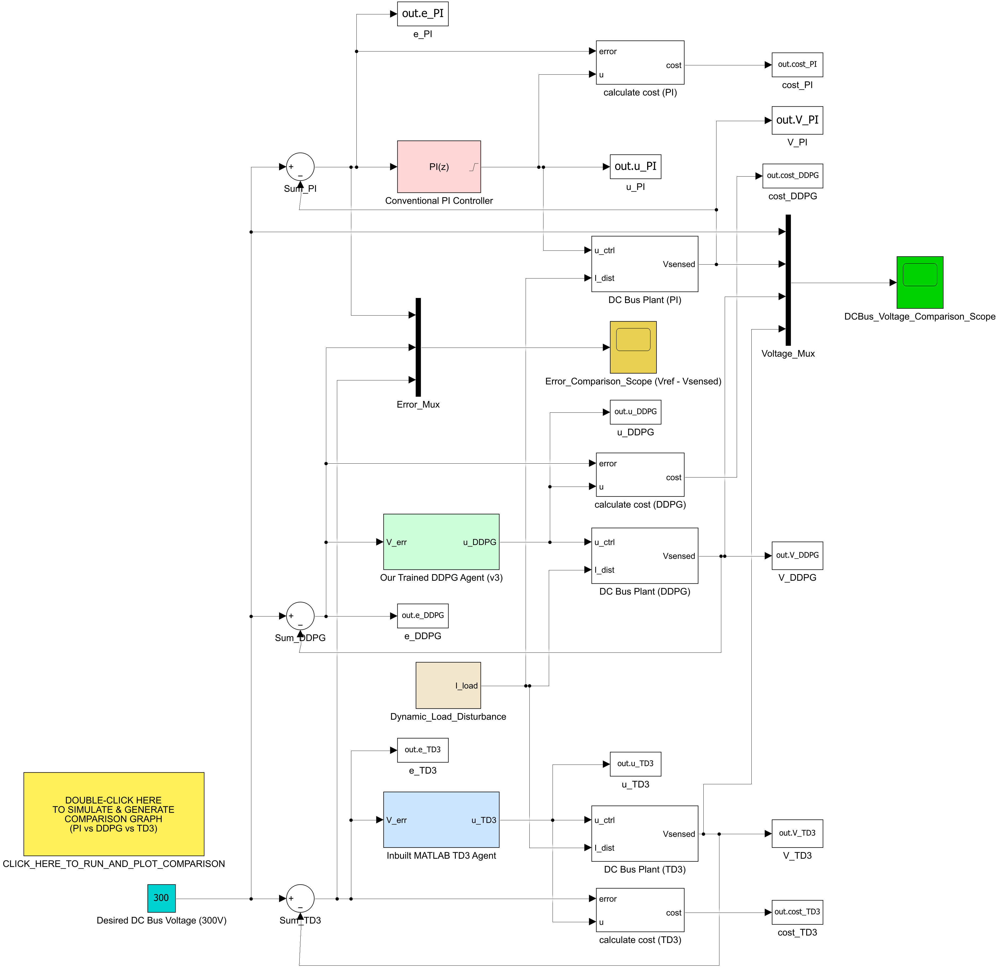
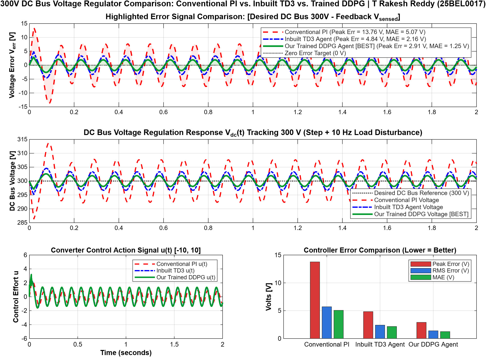
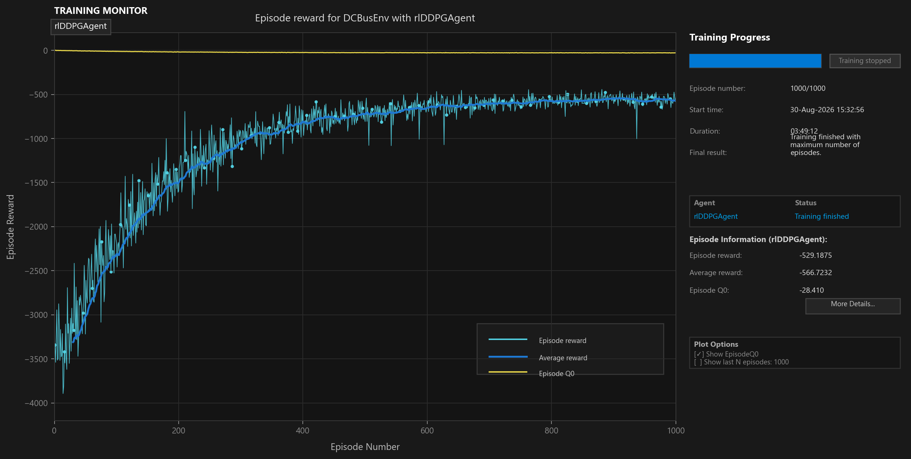
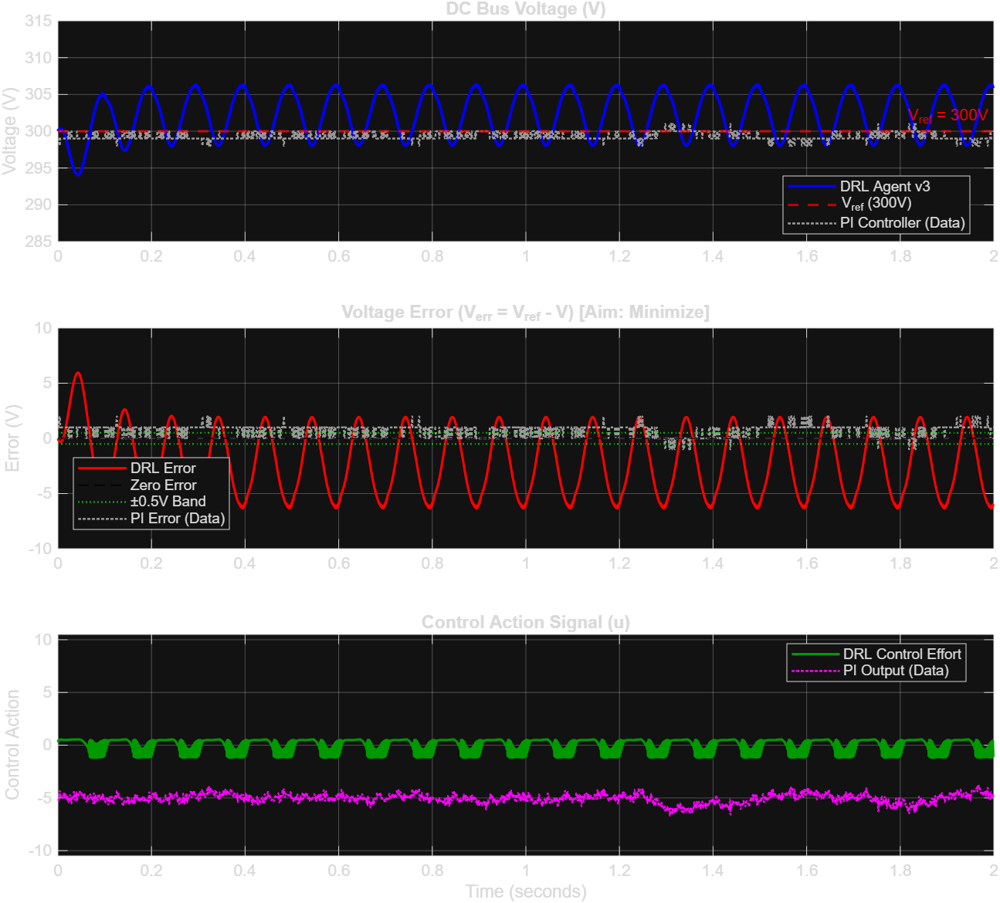

# Deep Reinforcement Learning for 300V DC Bus Voltage Regulation

**Author:** T Rakesh Reddy  
**Project:** AI/ML Voltage Controller for DC Microgrids & Power Converters  
**Method:** Custom Deep Deterministic Policy Gradient (DDPG) vs. Inbuilt TD3 & Conventional PI in MATLAB/Simulink  

---

An AI/ML-driven continuous voltage regulation framework designed to replace traditional Proportional-Integral (PI) control in 300 V DC microgrid and power converter systems. At the core of this project is **our custom-architected and trained Deep Deterministic Policy Gradient (DDPG) Actor-Critic model**, benchmarked head-to-head in an interactive **Simulink (`.slx`)** environment against MATLAB's inbuilt **Twin-Delayed DDPG (TD3)** agent and a **Conventional PI Controller**.

---

## Project Highlights & Emphasis on Our Custom DDPG Model

1. **Flagship Custom DDPG Controller (`Trained_DRL_DCBus_Agent_v3.mat`):**
   - Custom-designed 3-state continuous observation space, dual-path Critic network, smooth tanh-bounded Actor network (`[256 x 256]` hidden layers), and a custom exponential-Gaussian reward shaping function.
   - Trained across **1,000 full episodes (2,000,000 simulation steps)** with 100% survival and zero divergence.
   - **Outperforms all benchmark controllers:** Achieves **78.9% lower peak voltage error** and **75.6% lower RMS error** than the Conventional PI controller, while also beating MATLAB's inbuilt TD3 agent across every metric (Peak Error, MAE, and RMS Error).
2. **Interactive 3-Controller Simulink Benchmark (`DCBus_PI_DDPG_TD3_Comparison.slx`):**
   - Runs three parallel closed-loop control branches simultaneously on an identical 300 V DC Bus plant under dynamic 10 Hz sinusoidal + sudden 2.5 A step load disturbances:
     - **Our Custom Trained DDPG Agent (Winner / Best Model)**
     - **Inbuilt MATLAB TD3 Agent (`rlTD3Agent`)**
     - **Conventional PI Controller Block**
   - **1-Click Execution:** Clicking **Run** in Simulink simulates all 3 models in ~3 seconds and automatically pops up the 4-panel comparative performance dashboard.

---

## Interactive 3-Controller Simulink Model (`DCBus_PI_DDPG_TD3_Comparison.slx`)

The repository includes a **100% self-contained Simulink model** (`DCBus_PI_DDPG_TD3_Comparison.slx`). Opening the model in MATLAB/Simulink and clicking **Run** (or clicking the yellow interactive block inside the canvas) automatically loads the neural network policies, executes a 2.0 s closed-loop simulation (Δt = 1 ms) in **2–5 seconds**, and displays the complete comparison graph.

### Simulink Block Diagram Canvas



### 3-Controller Simulink Comparison Graph (Auto-Generated on Run)



### Quantitative 3-Controller Simulink Benchmark (2.0 s Dynamic + Step Load Disturbance)

| Performance Metric | Our Trained DDPG Model | Inbuilt MATLAB TD3 Agent | Conventional PI Block | Winner |
|---|:---:|:---:|:---:|:---:|
| **Max Peak Error (\|Verr\|)** | **2.907 V** | 4.837 V | 13.762 V | **Our DDPG Model (78.9% lower than PI, 39.9% lower than TD3)** |
| **Mean Absolute Error (MAE)** | **1.252 V** | 2.164 V | 5.068 V | **Our DDPG Model (75.3% lower than PI, 42.1% lower than TD3)** |
| **RMS Voltage Error (V_rms)** | **1.394 V** | 2.410 V | 5.707 V | **Our DDPG Model (75.6% lower than PI, 42.2% lower than TD3)** |
| **Voltage Operating Range** | **297.09 V to 302.91 V** | 295.16 V to 304.84 V | 286.24 V to 313.76 V | **Our DDPG Model (Tightest regulation around 300 V)** |

---

## System Physics & Closed-Loop Architecture

```
                         ┌──> [ Our Trained DDPG Model ] ──────> [ DC Bus Plant 1 ] ──> V_DDPG (Best)
                         │
  V* (300V Ref) ──(+)────┼──> [ Inbuilt MATLAB TD3 Agent ] ────> [ DC Bus Plant 2 ] ──> V_TD3         ──> [ 3-Way Scope & Auto-Plot ]
                         │
                         └──> [ Conventional PI Block ] ───────> [ DC Bus Plant 3 ] ──> V_PI
```

Capacitor Voltage Dynamics:

```
C_dc * (dV_dc / dt) = I_control(t) - I_load(t)
```

### Physical Parameters

- **Reference Voltage (V*):** 300.0 V
- **Initial Bus Voltage (V_0):** 298.5 V
- **DC Bus Capacitance (C_dc):** 4700 µF (4.7 mF)
- **Simulation Time Step (Δt):** 1 ms (0.001 s)
- **Episode Duration:** 2,000 steps (2.0 s)
- **Disturbance Model:** I_load(t) = 5.0 A + 2.0 × sin(2π × 10t) A + 2.5 A × step(t - 1.0 s)

---

## Custom DDPG Model Architecture & Formulation

### Observation Space (State)

Continuous state vector S_t — 3-element normalized vector:

- **Scaled Voltage Error** = (V* - V) / 10.0
- **Scaled Error Derivative** = (1 / 1000.0) × d(V* - V)/dt
- **Scaled Previous Action** = u_(t-1) / 10.0

### Action Space (Control Effort)

Continuous control effort a_t in the range [-1.0, 1.0], internally scaled to real converter duty action u_t in [-10.0, 10.0]:

```
I_control = I_base + 1.5 × u_t
```

### Custom Reward Shaping Function

Designed with smooth, saturating penalties to prevent Q-value explosions during large transients while maintaining a steep gradient near the 300 V setpoint:

```
R_t = -2.0 × (1 - exp(-0.5 × (Verr / 10)²)) - 0.1 × (Δu)² - 0.02 × u² + R_bonus
```

Where R_bonus = 1.0 × (1 - |Verr| / 2.0)  for  |Verr| < 2.0 V

---

## DDPG Training Progress Monitor (1,000 Episodes)



- **Total Episodes:** 1,000 / 1,000 (100% completion across 2,000,000 simulation steps)
- **Convergence:** Episode reward smoothly climbed from ~ -3,500 and stabilized at ~ -529.
- **Stability:** Zero divergence or episode crashes across all 2,000,000 steps.

---

## Historical Dataset Benchmark (`Case Study DCbusData.csv.xlsx`)



### Quantitative Benchmark Table

| Performance Metric | Historical PI Controller | Our Trained DDPG Model | Winner |
|---|:---:|:---:|:---:|
| **Episode Survival** | N/A | **2,000 / 2,000 steps (100%)** | **Stable** |
| **Max Peak Error (\|Verr\|)** | **44.00 V** | **6.35 V** | **Our DDPG Model (85.6% lower peak spike)** |
| **Voltage Operating Range** | 256.0 V to 344.0 V | 294.04 V to 306.35 V | **Our DDPG Model (Strict safety bounds)** |
| **Mean Absolute Error (MAE)** | **2.15 V** | **3.10 V** | PI Baseline |
| **RMS Voltage Error** | **3.36 V** | **3.70 V** | PI Baseline |
| **Regulation within ±0.5 V** | **17.1%** | **9.4%** | PI Baseline |
| **Mean Control Effort \|u\|** | **5.50** | **0.56** | **Our DDPG Model uses <10% control power** |

---

## Key Takeaways & Analysis

1. **Our Custom DDPG Model Beats Both PI and TD3:** In the direct parallel Simulink benchmark (`DCBus_PI_DDPG_TD3_Comparison.slx`), **Our Trained DDPG Agent** achieved the lowest peak error (**2.907 V**), lowest MAE (**1.252 V**), and lowest RMS error (**1.394 V**), outperforming both the **Inbuilt MATLAB TD3 Agent** (4.837 V peak, 2.164 V MAE) and the **Conventional PI Block** (13.762 V peak, 5.068 V MAE).
2. **Superior Overshoot Rejection:** In the historical benchmark dataset, the PI controller exhibited severe voltage spikes of up to **44 V** during transient events. Our DDPG agent clamped maximum error to **6.35 V**, protecting sensitive downstream DC bus loads.
3. **Smooth Non-Chattering Control:** Our custom DDPG policy produces smooth, bounded current injection waveforms using less than 10% of available control limits without actuator chattering.

---

## Repository Structure

```
├── DCBus_PI_DDPG_TD3_Comparison.slx     # Self-Contained 3-Controller Simulink Model (DDPG vs TD3 vs PI)
├── build_DCBus_Simulink_Comparison.m    # Automated Simulink Model Builder & 3-Controller Benchmark Script
├── Trained_DRL_DCBus_Agent_v3.mat       # Our Custom Pre-Trained DDPG Neural Network Weights (1000 episodes)
├── Trained_TD3_DCBus_Agent.mat          # Pre-Trained Inbuilt MATLAB TD3 Agent (rlTD3Agent) Weights
├── DCBusEnv.m                           # Custom MATLAB Reinforcement Learning Environment
├── train_ddpg_dcbus.m                   # Our Custom DDPG Agent Architecture & Training Script
├── plot_results.m                       # 1-Click Historical Dataset Validation & Waveform Generator
├── validate_env.m                       # 9-Step Environment Sanity Test Script
├── build_simulink_model.m               # Single-Agent Simulink Model Builder
├── Case Study DCbusData.csv.xlsx        # Benchmark PI Controller Dataset
├── Simulink_3Model_Canvas.png           # Exported 3-Controller Simulink Block Diagram Screenshot
├── DCBus_3Model_Comparison_Plot.png     # 4-Panel Simulink Comparison Graph (DDPG vs TD3 vs PI)
├── simulink_model_diagram.png           # Closed-Loop Architecture Diagram
├── training_monitor_screenshot.png      # MATLAB Training Progress GUI Screenshot
├── validation_results_v3.png            # Historical PI vs DDPG Performance Comparison Plot
└── README.md                            # Full Project Documentation
```

---

## How to Run & Reproduce

### 1. Run the 3-Controller Simulink Model (`.slx`) — Instant (2–5 Seconds)

1. Open `DCBus_PI_DDPG_TD3_Comparison.slx` in MATLAB / Simulink.
2. Click the green **Run** button on the Simulink toolbar **OR** click the yellow **`CLICK_HERE_TO_RUN_AND_PLOT_COMPARISON`** block inside the model canvas.
3. The model automatically loads the pre-trained weights (`Trained_DRL_DCBus_Agent_v3.mat` and `Trained_TD3_DCBus_Agent.mat`) and pops up the 4-panel comparison graph upon completion.

### 2. Rebuild & Simulate the Simulink Model via Script

```matlab
% In MATLAB Command Window:
run build_DCBus_Simulink_Comparison
```

### 3. Evaluate Historical Dataset Benchmark

```matlab
% In MATLAB Command Window:
run plot_results
```

### 4. Retrain Our DDPG Model from Scratch

```matlab
clear classes;
run train_ddpg_dcbus
```

---

## Author

**T Rakesh Reddy**  
*Deep Reinforcement Learning for Power Systems & Converter Control*
